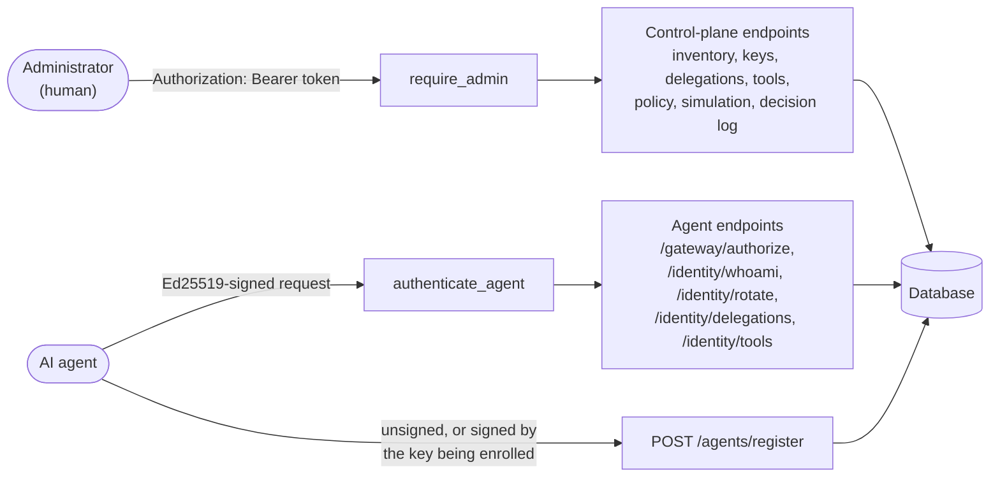
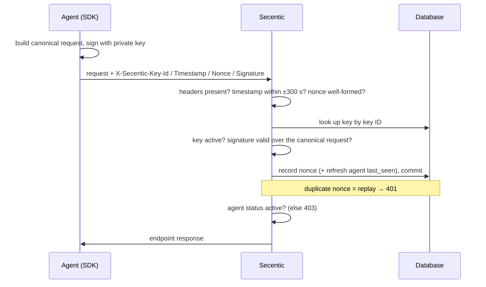
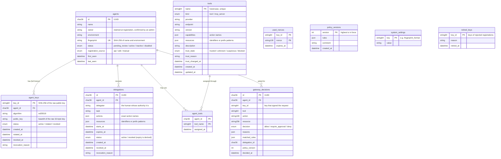
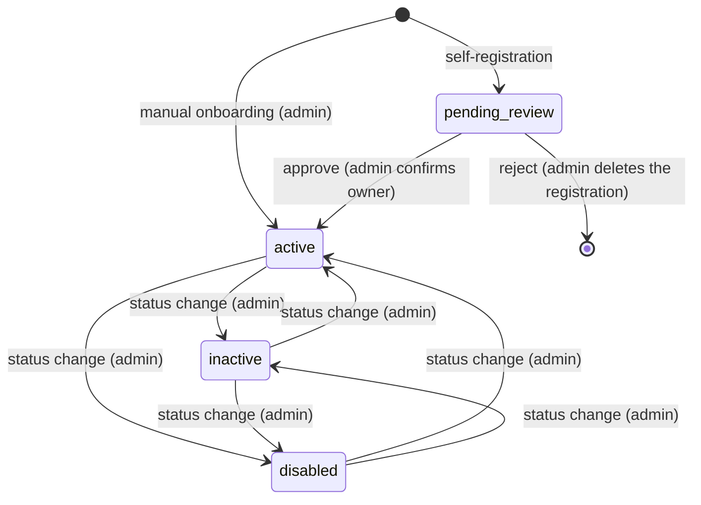
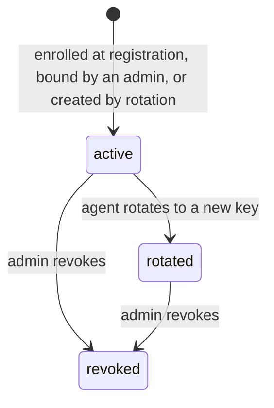

# Architecture

How the code that exists today is put together. For the big picture and the planned modules, see
[overview.md](overview.md).

## Technology

| Concern | Choice |
|---|---|
| Language | Python 3.10+ |
| Web framework | FastAPI (HTTP API, request validation, OpenAPI docs at `/docs`) |
| Database access | SQLAlchemy 2.0 ORM |
| Database | SQLite for development and tests, PostgreSQL (via `psycopg`) as the target |
| Validation | Pydantic v2 |
| Cryptography | `cryptography` (Ed25519 signatures) |
| Server | Uvicorn |
| Tests | pytest with FastAPI's `TestClient` |

## Code map

```
app/
  main.py             FastAPI app; startup checks DATABASE_URL, creates tables, refreshes
                      fingerprints; registers the routers
  database.py         engine and sessions from DATABASE_URL (foreign keys enforced on SQLite too);
                      get_db(); create_tables()
  models.py           SQLAlchemy models: Agent, AgentKey, UsedNonce, Delegation, Tool, AgentTool,
                      PolicyVersion, GatewayDecision, SystemSetting, RetiredKey, and their enums
  schemas.py          Pydantic request/response models; bounded input types (NonBlankStr,
                      Description, UtcInput, ...) with matching OpenAPI patterns; error_responses
  admin_auth.py       require_admin: bearer-token authentication for the control plane
  request_guards.py   trailing-slash handling, body size limit (413), the 422 and 405 handlers,
                      database errors as 503
  crypto.py           M2 primitives: key decoding (weak-key blocklist), canonical request, verify
  identity.py         M2 request authentication: header parsing, replay protection,
                      authenticate_agent dependency, new_agent_key helper
  delegation.py       M3 rules: resource/action validation and normalisation (canonical_form),
                      pattern matching, check_authority
  tools.py            M4 rules: tool names, definition changes that reset trust
  gateway.py          M5 decision pipeline: decide()
  policy.py           M6 engine: rule validation and normalisation, matching, evaluate_policy,
                      version_in_force
  utils.py            M1 helpers: fingerprint computation and startup fingerprint refresh
  routers/
    common.py         shared by every router: ADMIN dependency, ADMIN_ERRORS, path ID types
                      (AgentId, KeyId, DelegationId) and their URL convertors,
                      get_or_404, get_agent_or_404, commit_or_409, update_one
    agents.py         M1 endpoints: register, onboard, list, review queue, get, reject,
                      approve, change owner, change status
    identity.py       M2 endpoints: list/bind/revoke keys (admin), whoami and rotate (agent)
    delegation.py     M3 endpoints: create/list/get/revoke delegations and dry-run checks
                      (admin), the agent's own delegations (agent)
    tools.py          M4 endpoints: the registry, trust reviews, tool assignments (admin),
                      the agent's own tools (agent)
    gateway.py        M5 endpoints: authorize (agent), simulate and the decision log (admin)
    policy.py         M6 endpoints: the policy in force, versions, restore (admin)
secentic_sdk/         Python SDK used by agents (key handling, request signing, client)
examples/
  demo_agent.py       runnable agent used in the user guide walkthrough
tests/
  conftest.py         fixtures: isolated database, TestClient, admin header, make_agent
  test_agents.py      M1 behaviour
  test_identity.py    M2 behaviour, including attack scenarios
  test_delegation.py  M3 behaviour, including over-broad grants and path traversal
  test_tools.py       M4 behaviour, including the rug pull
  test_gateway.py     M5 behaviour: every check, prompt injection, failing closed
  test_policy.py      M6 behaviour: versions, rule validation, the evaluation itself
  test_input_safety.py hostile input: control characters, malformed IDs, oversized and nested bodies;
                      routing (405 and Allow, /agents without slash, HEAD /health)
  test_openapi.py     the OpenAPI schema matches the validators and declares auth and errors
  test_docs.py        keeps these docs in step with the code
docs/                 this documentation
.github/
  workflows/tests.yml GitHub Actions: runs the tests on SQLite and PostgreSQL for every push and PR
  pull_request_template.md   checklist, including the documentation updates
.env.example          template for .env (settings)
pytest.ini            makes the project root importable in tests
CHANGELOG.md          notable changes, newest first
CLAUDE.md             instructions for Claude Code sessions, including keeping these docs current
```

Each module owns a router (`app/routers/<area>.py`), its rules live in that router or in a
dedicated module file (like `identity.py`), and its tests live in `tests/test_<area>.py`.
Models and schemas are shared files for now.

## Two callers, two identities

There are exactly two kinds of caller, and they authenticate in completely different ways:



- **Administrators** (humans) use a bearer token (`require_admin` in `app/admin_auth.py`). This is
  an MVP stand-in for single sign-on, which is out of scope.
- **Agents** prove possession of their private key on every request (`authenticate_agent` in
  `app/identity.py`). They never use the admin token, and the admin token is not an agent identity.
- `POST /agents/register` and `GET /health` are the only endpoints usable without either.

This separation is a requirement of M2: agent identity is kept apart from human identity.

## Request lifecycles

### Administrator request

1. Bodies over 64 KiB (1 MiB for `PUT /policy`) are refused (413). FastAPI validates the path, query
   and body (422 on bad input).
2. `require_admin` compares the bearer token with `SECENTIC_ADMIN_TOKEN` in constant time
   (503 if the server has no usable token, 401 if it does not match).
3. The endpoint runs with a database session from `get_db`, commits, and returns a response model.

### Signed agent request



The full protocol, including the exact canonical format, is specified in
[modules/m2-agent-identity.md](modules/m2-agent-identity.md#request-signing-protocol).

### An agent asks the gateway

`POST /gateway/authorize` is a signed agent request like the one above. Once the agent is
authenticated, `decide()` in `app/gateway.py` checks the tool (M4), the delegation (M3), the tool's
trust and the policy (M6) in a fixed order, the router records the decision, and the agent gets
ALLOW, DENY or REQUIRE APPROVAL with every reason. Details: [M5](modules/m5-runtime-gateway.md#the-decision).

### Startup

`app/main.py` runs once when the server starts (not when the app is imported, so tests never
touch the configured database):

1. Refuse to start if `DATABASE_URL` is not set.
2. Create missing tables (`create_tables`). Existing tables are not altered. If another server
   process creates some of them at the same moment, a second pass creates the rest.
3. If the database records an older fingerprint format, recompute stored agent fingerprints
   once; otherwise this is a single lookup (see
   [M1](modules/m1-agent-inventory.md#deduplication)).

## Data model



Constraints that the database itself enforces, so they hold even under concurrent requests:

| Constraint | Purpose |
|---|---|
| `agents.fingerprint` unique | one record per agent (name + environment) |
| `agent_keys.key_id` primary key | a public key can be bound only once, ever |
| partial unique index `uq_agent_keys_one_active` on `agent_keys(agent_id) WHERE status = 'active'` | at most one active key per agent |
| `used_nonces (key_id, nonce)` primary key | a signed request cannot be accepted twice |
| `tools.name` primary key | one tool per name, so no tool can shadow another |
| `agent_tools (agent_id, tool_name)` primary key | an assignment exists at most once |
| `policy_versions.version` primary key | two concurrent policy saves cannot both become the same version (409) |

Concurrent changes are also guarded by conditional updates (`update_one` in
`app/routers/common.py`) rather than constraints: a key
rotation retires the old key, and a revocation revokes it, only `WHERE status = 'active'` (so
neither can overwrite the other); approving or updating a tool applies only if the tool did not
change since it was read; and approving or rejecting an agent applies only `WHERE status =
'pending_review'`. A tool's
`definition_hash` is computed from its fields, not stored.

All timestamps are stored in UTC. SQLite returns them without a timezone, so code compares stored
times through `as_utc()` (in `app/models.py`), and API responses always state the offset (`Z`)
whichever database is used.

`Agent.active_key` is a read-only relationship that loads only the active key with each agent;
the full history in `Agent.keys` is loaded only when needed (for example `GET /agents/{id}/keys`).

## Lifecycles

### Agent status



Only `active` agents can authenticate. Nothing moves back to `pending_review`, so every agent
outside the review queue has an owner an administrator confirmed.

### Key status



Rotated and revoked keys never become active again, and their public keys can never be bound
again. Keys are deleted only together with a rejected pending registration.

### Delegation state

A delegation is `scheduled`, `active`, `expired` or `revoked`. Only revocation is stored; the rest is
derived from the clock, so expiry needs no background job. Diagram and rules:
[M3](modules/m3-delegated-authority.md#time-window).

### Tool trust

A tool is `trusted`, `unknown`, `suspicious` or `blocked`. Administrators set it by recording a
review; the only automatic change is trusted → unknown when a trusted tool's definition changes.
Diagram and rules: [M4](modules/m4-agent-tool-registry.md#trust).

## Cross-cutting conventions

| Topic | Convention |
|---|---|
| Authentication | `dependencies=ADMIN` (from `app/routers/common.py`) on control-plane endpoints; `Depends(authenticate_agent)` on agent endpoints. Never both. |
| Failing closed | Missing configuration disables the feature (admin access, server start) instead of falling back to something permissive. |
| Errors | `HTTPException` with a human-readable `detail`. 401 = not authenticated, 403 = authenticated but not allowed, 404 = not found, 409 = conflicts with current state, 422 = invalid input, 503 = server not configured or the database failing (`database_error_handler`: fail closed, never a bare 500). |
| Transactions | One session per request (`get_db`). Commits that can hit a unique constraint go through `commit_or_409`, and updates that must not overwrite a concurrent change through `update_one` (a conditional UPDATE), so a race becomes a 409, never a 500 or a lost change. |
| Time | `utcnow()` from `app/models.py` for every timestamp; `as_utc()` before comparing stored ones. Timestamps in requests use `UtcInput` (timezone required, converted to UTC, out-of-range refused); responses use `UtcDatetime`. |
| Input | One-line text uses `NonBlankStr` (stored as sent: never blank, no surrounding spaces, no control or invisible characters, at most 200 characters); descriptions use `Description` (the same, up to 500). Request bodies are limited to 64 KiB (`app/request_guards.py`). |
| Path IDs | Routes write IDs as `{agent_id:uuid_id}`, `{delegation_id:uuid_id}` or `{key_id:key_id}`, so only well-formed IDs match a route (anything else is a 404, and `/agents/register` is never read as an ID); the parameters use `AgentId`, `DelegationId` and `KeyId`. |
| OpenAPI | Every route declares its errors with `responses=error_responses(...)`; agent-facing routes add `openapi_extra=SIGNED_REQUEST`. Each validator has an equivalent JSON Schema (`WithJsonSchema`), checked by `tests/test_openapi.py`. |
| Schema changes | No migrations yet: tables are created at startup. A change to an existing table means deleting the development database; record it in the changelog. |

## Where future modules plug in

| Module | Integration point |
|---|---|
| M7 Risk Engine | One more input to the gateway's "most restrictive" step in `decide()`, with its own explained reasons; advisory signals never relax a decision. |
| M8 Human Approval | Acts on `require_approval` decisions by their ID in `gateway_decisions`, binding the approval to that exact agent, tool, action and resource. |
| M9 Activity & Investigation | Builds on the decision log (`GET /gateway/decisions`) and adds search and the activity graph. |
| M10 Quarantine | Builds on disabling agents, revoking keys and delegations, and blocking tools. |
| M11 Audit | Hash-chains the decision log and every administrative change (approvals, keys, delegations, trust, policy versions). |
| M12 Dashboard | Reads the inventory, registry, decision log and policy versions; delegations versus decisions give granted-versus-used permission analytics. |
