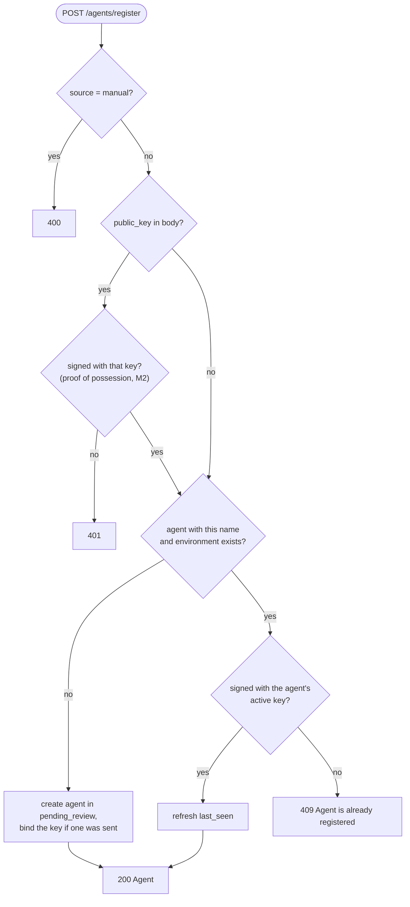

# M1 — Agent Discovery & Asset Inventory

| | |
|---|---|
| Status | Implemented |
| Semester | FYP-I (weeks 5–6) |
| Owner | Ali |
| Code | `app/routers/agents.py`, `app/utils.py`, `Agent` in `app/models.py` |
| Tests | `tests/test_agents.py` |

## Purpose

Organisations often do not know which AI agents are running ("shadow agents"), who owns them, or
when they were last active. M1 keeps an **inventory**: one record per agent with its owner,
environment, status, and first-seen and last-seen times. Every later module (identity,
delegation, the gateway, the dashboard) builds on this record.

From the proposal: *register and discover AI agents (via API/SDK registration and manual
onboarding), deduplicate observations into a single asset record, and track first-seen,
last-seen, owner, environment and status.*

## How agents enter the inventory

| Path | Who | Endpoint | Starts as |
|---|---|---|---|
| Self-registration | the agent, through the API or the SDK | `POST /agents/register` | `pending_review` |
| Manual onboarding | an administrator | `POST /agents` | `active` |

**Self-registration always starts in `pending_review`**, even when the agent claims an owner. A
claim is not proof: any program can call the API and name any owner. The owner is recorded so
the reviewer can see it, and an administrator confirms (or corrects) it with
`POST /agents/{id}/approve?owner=...`. Only then does the agent become `active`.

Administrators can also **reject** a pending registration (`DELETE /agents/{id}`). This deletes
the record and frees the name, which is how a name taken by someone else is recovered. The
registration's key is retired for good (`retired_keys`): whoever squatted the name cannot simply
register again with the same key, under that name or any other.

## Deduplication

An agent is identified by its **name and environment**, compared by one defined Unicode rule:
NFKC normalisation with full case folding (`identity_text` in `app/utils.py`). `Billing-Bot`,
`billing-bot` and full-width `ｂｉｌｌｉｎｇ-ｂｏｔ` are one name, as are `straße` and `strasse`, and an
accented letter typed as one character or as a letter plus an accent mark. Names are
visible, single-line text: no leading or trailing spaces of any kind and no invisible characters,
so two records can never look identical while being different, nor look blank. Invisible is decided
by Unicode properties rather than a hand-made list: every control, format, surrogate and
private-use character, line and paragraph separators, Unicode's default-ignorable characters (such
as zero-width characters, bidirectional controls, variation selectors and Hangul fillers) and
blank-looking letters such as the Braille blank are refused. Environments are stricter still:
plain ASCII names (`prod`, `eu-west-1`), because policy rules select agents by environment and a
look-alike such as `prоd` (with a Cyrillic `о`) would escape every rule on `prod`. Secentic stores a fingerprint, the
SHA-256 of the JSON array `["<name>", "<environment>"]` in that compared form, with a unique constraint, so the inventory can never hold the same
agent twice, even when two registrations race.

The owner is deliberately **not** part of the identity: it is an attribute that changes (on
approval, or when responsibility moves to someone else), and including it made the same agent
appear twice.

Older versions computed fingerprints differently: the first M1 version also hashed the owner,
later versions joined the two fields with `|`, which made `billing|prod` in `eu` and `billing`
in `prod|eu` the same agent, and before format 3 names were only lower-cased. The database records which fingerprint format it uses
(`system_settings`); when the server starts and finds an older format, it recomputes every
fingerprint once (`ensure_current_fingerprints` in `app/utils.py`), and afterwards startup costs a
single lookup. If an old database already contains the same agent twice, the server stops with an
explanation instead of guessing which record to keep.

The first M1 version also made any agent that merely *claimed* an owner `active`, without review.
The upgrade recognises those agents (they still carry that version's fingerprint, computed with
the claimed owner) and sends them back to `pending_review`, so every active agent has an owner an
administrator confirmed. Agents an administrator approved in that version stay active.

Several server processes may start on the same database at once (e.g. `--workers 4`); creating the
tables and the upgrade both tolerate another process doing the same work at the same moment.

## Registration rules

Once an agent exists, **only its own enrolled key can speak for it**. Every other repeat
registration (unsigned, signed by another key, or for an agent that has no key) gets the same 409.
That means a stranger who knows an agent's name cannot:

- read its owner or status (the answer is identical whatever the agent's state);
- make it look alive by refreshing `last_seen`;
- attach their own key to it (keys for existing agents come only from an administrator, see M2).

## Status

| Status | Meaning | Can authenticate |
|---|---|---|
| `pending_review` | Registered, waiting for an administrator | no |
| `active` | Approved and in use | yes |
| `inactive` | Approved, but taken out of service | no |
| `disabled` | Approved, but switched off (e.g. suspected misuse) | no |

Administrators move approved agents between `active`, `inactive` and `disabled` with
`POST /agents/{id}/status`, and change their owner with `PUT /agents/{id}/owner`. Nothing returns
to `pending_review` (except, once, the unreviewed agents of the first M1 version; see
[Deduplication](#deduplication)), so every agent outside the review queue has an owner an
administrator confirmed. Approving and rejecting each apply only while the agent is still pending,
so when two administrators act on the same agent at once, the second gets 404 or 409 instead of
undoing the first. The full state diagram is in [architecture.md](../architecture.md#agent-status).

## First seen and last seen

- `first_seen` is set when the record is created.
- `last_seen` means "Secentic **verified** this agent was alive". It is refreshed only by a
  registration signed with the agent's enrolled key, or by an authenticated agent request (M2), at
  most once a minute so busy agents do not rewrite their record on every request. Unsigned requests
  never move it, because anyone could send them, and neither do inactive or disabled agents: their
  signed re-registration is refused (403).

Agents without a key therefore keep the `last_seen` of their registration. Giving them a key
(M2) is what makes their activity visible.

## Endpoints

Full details in the [API reference](../api-reference.md#inventory-m1).

| Endpoint | Caller | Purpose |
|---|---|---|
| `POST /agents/register` | agent | self-registration |
| `POST /agents` | admin | manual onboarding |
| `GET /agents`, `GET /agents/{agent_id}` | admin | inventory |
| `GET /agents/review-queue` | admin | agents waiting for review |
| `POST /agents/{agent_id}/approve` | admin | confirm owner, activate |
| `DELETE /agents/{agent_id}` | admin | reject a pending registration |
| `PUT /agents/{agent_id}/owner` | admin | change owner |
| `POST /agents/{agent_id}/status` | admin | active / inactive / disabled |

## Design decisions

| Decision | Why |
|---|---|
| Identity = name + environment | The same agent registering again must map to the same record; owners change. |
| Self-registration is never auto-approved | A claimed owner is unverifiable; auto-approval let any program activate itself. |
| Same 409 for every rejected repeat | Different messages would reveal an agent's owner, status or key state to anyone. |
| Only pending registrations can be deleted | Approved agents have history worth keeping; they are disabled instead. |
| Inventory endpoints need the admin token | The inventory (owners, environments, statuses) is sensitive. |

## Limitations and future work

- Discovery is registration-based: agents (or an administrator) must register them. Passive
  discovery, such as scanning cloud or Kubernetes environments, is out of scope for the FYP.
- Registration is first come, first served for a name. An administrator resolves a squatted name
  by rejecting the registration; an admin-issued enrollment token would prevent it entirely
  (see [security.md](../security.md#residual-risks)).
- Lists are not paginated.
- Changes to agents are not yet written to an audit log (M11).
