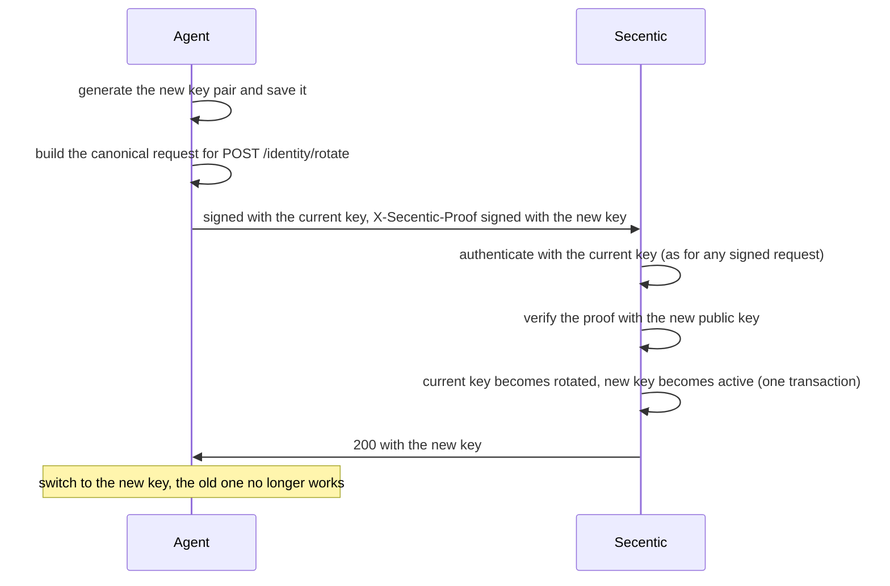

# M2 — Agent Identity & Non-Human Identity

| | |
|---|---|
| Status | Implemented |
| Semester | FYP-I (weeks 6–7) |
| Owners | Ali, Areeb |
| Code | `app/crypto.py`, `app/identity.py`, `app/routers/identity.py`, `AgentKey` and `UsedNonce` in `app/models.py`, `secentic_sdk/` |
| Tests | `tests/test_identity.py` |

## Purpose

Before Secentic can decide what an agent may do, it must know **which agent is asking**, and
that must not be something the agent can simply claim. M2 gives every agent a **cryptographic
identity**: an Ed25519 key pair whose private half only the agent holds. Every agent request is
signed, so Secentic can verify who sent it, that it was not altered, and that it is not a replay.

From the proposal: *a unique cryptographic identity for every registered agent, using asymmetric
key pairs for request authentication, with support for key rotation, revocation and replay
protection, kept fully separate from human user identity.*

## Concepts

| Term | Meaning |
|---|---|
| Key pair | An Ed25519 private key (kept by the agent, never sent anywhere) and its public key (given to Secentic) |
| Key ID | SHA-256 (hex) of the raw 32-byte public key; identifies the key, and through it the agent |
| Proof of possession | A signature made with a private key, showing the sender really holds it |
| Canonical request | The exact bytes that get signed: method, path, query, body hash, timestamp, nonce |
| Nonce | A random value used once; seeing it again means the request is a replay |

Separation from human identity: administrators authenticate with a bearer token, agents with
signatures, and neither credential works for the other's endpoints (see
[architecture.md](../architecture.md#two-callers-two-identities)).

## Getting a key: enrolment

There are three ways a public key becomes an agent's active key:

| Path | Who | How | Proof of possession |
|---|---|---|---|
| At registration | the agent | `public_key` in `POST /agents/register`, request signed with that key | yes |
| Bound by an administrator | an admin | `POST /agents/{agent_id}/keys` with a key the operator supplied out of band | the admin vouches for it |
| Rotation | the agent | `POST /identity/rotate`, see [Key rotation](#key-rotation) | both the old and the new key sign |

Rules:

- **Self-enrolment happens only when the registration creates the agent.** An agent that already
  exists, pending or approved, gets keys only from an administrator. Otherwise anyone who knew
  an agent's name could attach their own key to it and, once an administrator approved the agent,
  act as it.
- **An agent has at most one active key.** The database enforces this with a partial unique index.
- **A public key can be bound only once, ever.** Rotated and revoked keys can never come back,
  and neither can the key of a rejected registration (it is kept in `retired_keys`).
- **Weak keys are refused** (see [Weak keys](#weak-keys)).
- Before approving a self-registered agent, the reviewer should confirm with its operator that the
  `active_key_id` shown in the review queue is theirs.

## Request signing protocol

This is the contract between agents and Secentic. The Python SDK implements it; agents in other
languages must implement it exactly.

### Headers

| Header | Value |
|---|---|
| `X-Secentic-Key-Id` | Key ID (64 lowercase hex characters) |
| `X-Secentic-Timestamp` | Current time as integer Unix seconds |
| `X-Secentic-Nonce` | 16–128 characters from `A-Z a-z 0-9 _ -`, new for every request |
| `X-Secentic-Signature` | Base64 (standard alphabet, with padding) of the Ed25519 signature over the canonical request |
| `X-Secentic-Proof` | Only for rotation: the new key's signature over the same canonical request (base64, 88 characters) |

### Canonical request

The canonical request is these eight lines joined with a single `\n` (no trailing newline),
encoded as UTF-8:

```
SECENTIC-V1
<HTTP method, upper case>
<path as the server routes it: percent-decoded, without a trailing "/" (except "/" itself), no query string>
<query string, exactly as sent, without the "?"; empty line if there is none>
<key ID>
<timestamp, exactly as in the header>
<nonce, exactly as in the header>
<SHA-256 hex (lowercase) of the raw request body; for an empty body, of the empty string>
```

Sign the bytes that are actually sent: serialise the JSON body once, hash and send those exact
bytes. A proxy that rewrites the path or re-encodes the body breaks the signature. The server takes
the path and query from the request it actually routes, never from a URL rebuilt from the `Host`
header, so a signature for one endpoint can never be made to verify on another.

### Verification

Secentic checks, in this order, and stops at the first failure:

1. All four headers are present and well formed (key ID: 64 lowercase hex characters;
   signature: 88 base64 characters; nonce: 16–128 URL-safe characters), and the timestamp is
   within **300 seconds** of the server's clock (either direction).
2. The key ID exists **and** the signature is valid for the canonical request rebuilt from what
   the server received. Both failures give the same answer, `Invalid signature`, so someone who
   cannot sign learns nothing about a key: not whether it exists, nor whether it was revoked.
3. The key is `active` (not `rotated` or `revoked`). Only a correctly signed request gets to learn this.
4. The nonce has not been used with this key before. It is then recorded and committed at once,
   on the request's own database connection: it is spent even if the endpoint later fails.
   Authentication runs before the endpoint changes anything; if anything else were pending, it
   would be refused rather than committed along. About once a minute, expired nonces are purged
   first, in a commit of their own, so a replay refused afterwards neither undoes the purge nor
   leaves it due for the next request.
5. The agent is `active` (otherwise 403).

On success the agent's `last_seen` is refreshed, at most once a minute, in the same commit that
spends the nonce. A registration that enrols a
key checks steps 1, 2 and 4 against the key in the request body, and also requires the key ID
header to match it. An existing agent re-registering may instead leave the key out of the body and
just sign with its active key. Any other signed registration without its key (another key, a
replay, or a name nobody holds) is refused with one 401, whether or not the name exists: there is
nothing to check the signature against, a signature is never ignored, and signed requests cannot be
used to find out which names are taken.

### Parameters

| Parameter | Value | Where |
|---|---|---|
| Signature algorithm | Ed25519 (RFC 8032) | `app/crypto.py` |
| Protocol version line | `SECENTIC-V1` | `SIGNATURE_VERSION` |
| Accepted clock difference | 300 s | `MAX_CLOCK_SKEW` in `app/identity.py` |
| Nonce memory | 600 s past the request timestamp | `NONCE_RETENTION` |
| Expired-nonce sweep | at most every 60 s | `NONCE_PURGE_INTERVAL` |

### Test vector

Use this to check another implementation. It registers an agent; Ed25519 signatures are
deterministic, so an implementation must reproduce the signature byte for byte.
(`tests/test_docs.py` recomputes it, so it always matches the code.)

```
private key (raw, hex): 000102030405060708090a0b0c0d0e0f101112131415161718191a1b1c1d1e1f
public key (base64):    A6EHv/POEL4dcN0Y50vAmWfk1jCbpQ1fHdyGZBJVMbg=
key ID:                 56475aa75463474c0285df5dbf2bcab73da651358839e9b77481b2eab107708c
request:                POST /agents/register?source=sdk
body (exact bytes):     {"name":"vector-bot","public_key":"A6EHv/POEL4dcN0Y50vAmWfk1jCbpQ1fHdyGZBJVMbg="}
timestamp:              1760000000
nonce:                  test-vector-nonce-0001
```

Canonical request:

```
SECENTIC-V1
POST
/agents/register
source=sdk
56475aa75463474c0285df5dbf2bcab73da651358839e9b77481b2eab107708c
1760000000
test-vector-nonce-0001
d98f2b3d0b6d8d1b2ef6b565587b4e1faf3d2cb585e4127c703e7d3dd6e40af4
```

Signature (base64):

```
oc96J8zXfZxx8NDO/TMStSqzQqhO78Yp919dq0VtMw8SufvSdN/ek7NxbcJLZEwwxEIw/TCOn2ln+XQwzTJaCQ==
```

## Replay protection

Two mechanisms work together:

- **Timestamp window**: a request older (or newer) than 300 s is refused outright.
- **Nonce memory**: within the window, each nonce is accepted once per key. Nonces are stored in
  the `used_nonces` table, so this works across server processes, and the table's primary key
  makes even simultaneous copies fail: of 10 identical requests sent at once, exactly one succeeds.

Nonces are remembered for **twice** the window (600 s past their timestamp). If they were dropped
exactly when the window closed, a replay arriving at the last accepted second could pass the
timestamp check just before the original nonce was swept away. Expired nonces are swept at most
once a minute.

## Key rotation

An agent replaces its own key with `POST /identity/rotate`. The agent must prove it holds **both**
keys: the request is signed with the current key as usual, and the new key signs the same
canonical request into the `X-Secentic-Proof` header.



There is no grace period: the old key stops working the moment the rotation commits. If two
rotations race, one wins and the others get 409 (or 401 if they arrive after the first finished).

The old key is retired only if it is still active at that moment. If an administrator revokes it
while a rotation is in flight (for example, because it was stolen and the thief is trying to swap
it for a key of their own), the revocation stands, nothing is changed, and the rotation gets 409.

If the response is lost after the server committed the rotation, the agent would be left holding
only a dead key. The SDK prevents this: it accepts a new key the caller has already saved, and
raises `RotationInterrupted` (carrying the new key) when no definite answer arrives. See
[sdk.md](../sdk.md#rotating-keys-safely).

## Revocation and recovery

An administrator revokes a key with `POST /agents/{agent_id}/keys/{key_id}/revoke`, optionally
recording a reason. A revoked key fails authentication immediately (401 `Key has been revoked`)
and can never be bound again.

Only the agent's **active** key can be revoked. Revoking a key that is already rotated or revoked is
refused (409), and the answer names the agent's current key. This matters after a theft: if the
thief has already rotated the stolen key to one of their own, revoking the stolen key would change
nothing, and a success message would wrongly suggest the agent is safe. Revoke the key it names, or
disable the agent. The revocation applies only while the key is still active, so a rotation landing
at the same moment cannot slip a new key past it. To recover the agent, the operator generates a new key pair and an
administrator binds its public key with `POST /agents/{agent_id}/keys`.

Disabling an agent (M1 status) is different: it is reversible and keeps the key; revocation is
permanent for that key.

## Weak keys

Some Ed25519 public keys, the 8 "small-order" points of the curve, are broken by construction:
signatures for them can be forged without any private key. For example, with the public key
`01 00 … 00`, the signature `R = 01 00 … 00, S = 0` verifies for **every** message. The
`cryptography` library accepts such signatures, so Secentic refuses these keys itself:
`load_public_key` in `app/crypto.py` rejects the 7 encodings of these points (the same blocklist
libsodium uses), with or without the sign bit. They are refused at registration, at
administrator binding and at rotation, and they can never verify a signature.

## Using M2 from other modules

Any endpoint that agents call should depend on `authenticate_agent`. It runs the whole
verification above and returns the verified caller, or fails with 401/403 before the endpoint runs:

```python
from fastapi import APIRouter, Depends
from app.identity import AgentPrincipal, authenticate_agent

router = APIRouter(prefix="/gateway", tags=["gateway"])

@router.post("/actions")
def request_action(principal: AgentPrincipal = Depends(authenticate_agent)):
    agent = principal.agent        # the verified, active Agent
    key = principal.key            # the AgentKey that signed this request
    ...
```

`principal.request` holds the verified header values and the canonical bytes, which is what M8
approvals or M11 audit records can bind to.

## Endpoints

Full details in the [API reference](../api-reference.md#identity-m2).

| Endpoint | Caller | Purpose |
|---|---|---|
| `GET /agents/{agent_id}/keys` | admin | key history |
| `POST /agents/{agent_id}/keys` | admin | bind a key |
| `POST /agents/{agent_id}/keys/{key_id}/revoke` | admin | revoke a key |
| `GET /identity/whoami` | agent | check identity |
| `POST /identity/rotate` | agent | rotate key |

Registration with a key goes through `POST /agents/register` (M1).

## Design decisions

| Decision | Why |
|---|---|
| Ed25519 | Small keys and signatures, fast, deterministic (no random number needed to sign), widely supported. |
| The agent generates its key | The private key never leaves the agent; Secentic stores only public keys, so a database leak exposes no credentials. |
| Key ID = SHA-256 of the public key | Any party can compute it locally; no lookup table needed. |
| Signatures cover method, path, query, body, time and nonce | Nothing in a request can be altered or replayed without detection. |
| Nonces in the database | Replay protection survives restarts and works across several server processes. |
| One active key, no rotation grace period | One rule that is easy to reason about; the SDK makes switching keys atomic for the agent. |
| A custom canonical format rather than RFC 9421 HTTP Message Signatures | Far simpler to implement and explain; could be replaced later behind the same `authenticate_agent` interface. |

## Limitations and future work

- The first key for a new agent is trusted on first use, until an administrator approves the
  agent; an admin-issued enrollment token would remove that window.
- Keys do not expire on their own; rotation is up to the agent's operator.
- Agents need a clock within 5 minutes of the server's.
- Key events are not yet written to an audit log (M11).

Residual risks for the system as a whole are listed in [security.md](../security.md#residual-risks).
