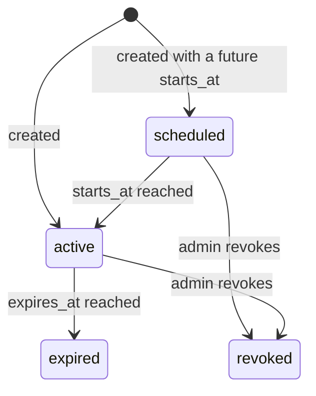
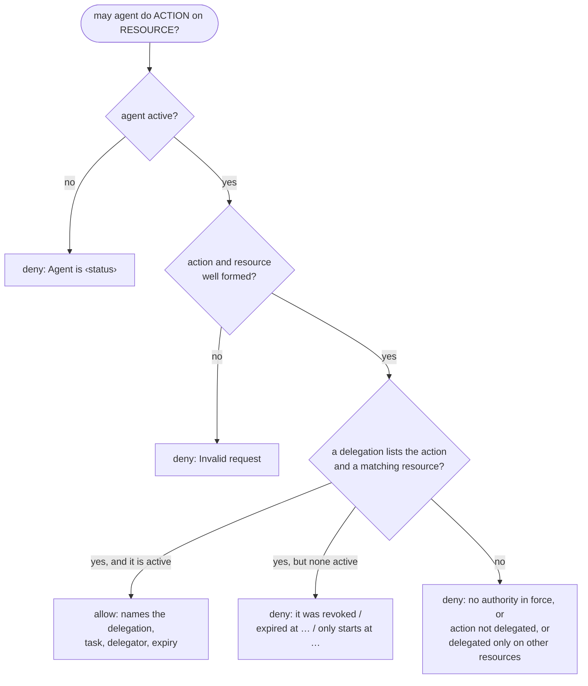

# M3 — Delegated Authority

| | |
|---|---|
| Status | Implemented |
| Semester | FYP-I (weeks 8–9) |
| Owners | Bakhtiar, Areeb (per proposal) |
| Code | `app/delegation.py`, `app/routers/delegation.py`, `Delegation` in `app/models.py` |
| Tests | `tests/test_delegation.py` |

## Purpose

Agents are usually over-privileged: they run with a person's or a service account's full
permissions, although the task at hand needs a fraction of them. When an agent is manipulated (for
example by a prompt injection), everything those permissions allow is at risk, and afterwards
nobody can say whose authority the agent was using.

M3 makes authority **explicit**. An agent holds no permissions of its own. A human *delegates*
exactly what a task needs: these actions, on these resources, for this task, until this time.
Everything not delegated is denied.

From the proposal: *an explicit human-to-agent delegation model that scopes an agent's permissions
to a specific task, resource and action set, with expiration and revocation, preventing automatic
inheritance of a full human or service-account permission set.*

## Delegations

A delegation records:

| Field | Meaning | Example |
|---|---|---|
| `delegator` | The human whose authority is delegated, and who is accountable for it | `ali` |
| `task` | What the authority is for | `Prepare the monthly sales report` |
| `actions` | Exact action names the agent may perform (stored in lower case) | `["read"]` |
| `resources` | Resources the actions apply to, exact or as prefix patterns | `["crm:accounts/*", "crm:reports/2026-09"]` |
| `starts_at` | When it comes into force (default: now; never in the past) | `2026-10-06T09:00:00Z` |
| `expires_at` | When it ends; required | `2026-10-13T09:00:00Z` |

An agent can hold several delegations, from different people for different tasks. Each is
independent: the agent's authority is the union of the delegations in force at that moment.

### Resources and actions

**Resource identifiers** name what an action touches. The convention is `system:path`, such as
`crm:accounts/42`, `mail:outbox/ali` or `s3:reports/2026/q3.pdf`. Identifiers are case-sensitive
and use a restricted alphabet (`A–Z a–z 0–9 . _ ~ : / @ + = , -`, up to 256 characters), with
no empty, `.` or `..` segments, where both `/` and `:` separate segments. Without these rules,
`crm:accounts/../admin` would fall under a grant for `crm:accounts/*`, `crm:../admin` under
`crm:*`, and an encoded `%2e%2e` could hide the same trick from the check. Empty segments (a
doubled, leading or trailing separator, as in `crm:accounts//secret`) are refused because they are
other spellings of the same resource: `crm:accounts//secret` would fall under a delegation for
`crm:accounts/*` but slip past a policy rule on `crm:accounts/secret*`.

**One spelling per resource.** Because `/` and `:` both separate segments, `crm:accounts/42`,
`crm:accounts:42` and `crm/accounts/42` name the same resource. Secentic normalises every resource
it receives (in delegations, tool definitions, policy rules and gateway requests) to one canonical
spelling: the system name, one `:`, then the path joined with `/`. So `crm:accounts:42` is stored,
checked and recorded as `crm:accounts/42`, and `redis:user:42:profile` as `redis:user/42/profile`.
Case is kept, because resource IDs are often case-sensitive (`Invoice-7aB3` and `invoice-7ab3` may be
different records). This is the normalisation step of the proposal's authorization flow: every
module (and later the approval workflow, activity search and permission analytics) compares one
form, so no spelling can fall under a grant yet escape a rule or an approval.

**Resource patterns** in a delegation are either an exact identifier or a **prefix ending in
`*` directly after `/` or `:`**, where the part before the first `/` or `:` (the system name)
contains a letter or digit. Patterns are at most 256 characters, `*` included:

| Pattern | Matches | Does not match |
|---|---|---|
| `crm:reports/2026-09` | exactly `crm:reports/2026-09` | `crm:reports/2026-10` |
| `crm:accounts/*` | `crm:accounts/42`, `crm:accounts/42/notes` | `crm:accounts`, `crm:accounts-archive/1` |
| `mail:*` | everything in the `mail` system | `crm:accounts/42` |

Refused, so that nobody can hand an agent blanket authority by accident: `*`, `/*`, `:*`,
`/crm/*` (no system name), `crm:acc*` (a wildcard not after a separator), and wildcards anywhere
but the end.

**Actions** are exact names such as `read`, `write`, `email.send` or `crm:update` (letters, digits,
`_ . : -`). Wildcards are not allowed: an agent gets a specific action set, never "everything".
Action names are ours rather than external IDs, so they are normalised to lower case: `CRM:Update`
and `crm:update` are one action.

### Time window

Every delegation expires, and it lasts at most **30 days** (`MAX_DELEGATION_LIFETIME`). It cannot
be backdated: `starts_at` may lie at most 5 minutes in the past (`MAX_BACKDATING`, for clock
differences), so a delegation never claims to have been in force before it was created. Times are
RFC 3339 strings with a timezone (for example `2026-10-13T09:00:00Z` or `...+05:00`); numbers,
number strings (which would otherwise be read as Unix times) and looser forms are refused, so no
delegation gets a window nobody meant. Secentic stores and returns them in UTC. A delegation's **state** is derived from the clock:



Only `active` delegations grant anything. Revocation takes effect immediately and is permanent.
A question about an earlier moment (`at`) counts a revocation only from `revoked_at` on, so it gets
the answer that was true then. Two administrators revoking the same delegation at once: the first
revocation's time and reason stand, the second gets 409.
An expired delegation is not renewed: a new one is created, so every grant has its own record.

### Who can delegate

Delegations are recorded through the control plane, so an administrator enters them on behalf of
the human named as `delegator`. That mirrors how M1 handles owners: Secentic does not yet have
individual logins for people, so the administrator vouches for the delegator. Pending agents cannot
receive authority (approve them first), and agents can never grant authority to themselves.

## The authority check

`check_authority(db, agent, action, resource, at=None)` in `app/delegation.py` decides whether an
agent may perform an action on a resource at a moment (default: now). It is deterministic and
always gives a reason:



When several delegations cover a request, the oldest one decides, so the answer never depends on
database ordering. Only the delegations in force are loaded to decide. A denial that names a
delegation which "covers this request but expired" looks for it among the agent's latest 100
delegations (`EXPLANATION_HISTORY`), so an agent with a long history is not slower to deny. This
limits only the explanation: the decision always considers every delegation in force, however old. Anything malformed or unknown, including a moment that has no UTC equivalent,
is denied: the function never raises for bad input, because the gateway must fail closed.

Example reasons:

```
Allowed by delegation 149258e9-…: task 'Prepare the monthly sales report', delegated by ali, valid until 2026-10-13T05:17:57Z
No delegation in force grants the action 'write'
'read' is delegated only on crm:accounts/*, crm:reports/2026-09, not on 'crm:invoices/7'
Delegation 149258e9-… covers this request but expired at 2026-10-13T05:17:57Z
The agent has no delegated authority in force
```

Administrators can run the same check as a dry run with `POST /agents/{agent_id}/check-authority`,
optionally at another moment (`"at"`), for example "will this still be allowed next week?".

## Endpoints

Full details in the [API reference](../api-reference.md#delegated-authority-m3).

| Endpoint | Caller | Purpose |
|---|---|---|
| `POST /agents/{agent_id}/delegations` | admin | delegate authority |
| `GET /agents/{agent_id}/delegations` | admin | list, optionally by state |
| `GET /agents/{agent_id}/delegations/{delegation_id}` | admin | one delegation |
| `POST /agents/{agent_id}/delegations/{delegation_id}/revoke` | admin | withdraw it |
| `POST /agents/{agent_id}/check-authority` | admin | dry-run authority check |
| `GET /identity/delegations` | agent | the agent's own delegations in force |

From the SDK, an agent reads its authority with `client.delegations()`.

## Using M3 from other modules

The M5 gateway authenticates the agent (M2), then asks M3 whether the requested action is
delegated, before anything else:

```python
from app.delegation import check_authority
from app.identity import AgentPrincipal, authenticate_agent

@router.post("/actions")
def request_action(body: ActionRequest, principal: AgentPrincipal = Depends(authenticate_agent),
                   db: Session = Depends(get_db)):
    authority = check_authority(db, principal.agent, body.action, body.resource)
    if not authority.allowed:
        ...  # DENY, with authority.reason as the explanation
    delegation = authority.delegation   # whose authority, for which task: for M6 policy and M11 audit
```

## Design decisions

| Decision | Why |
|---|---|
| Deny unless delegated | Least privilege: an agent's authority is the sum of explicit grants, never inherited. |
| Exact actions, prefix-only resource patterns | Easy to read and to reason about; no regular expressions or globbing surprises. |
| Wildcards only after `/` or `:`, never bare | Prevents accidental blanket grants such as `*` or `crm:acc*`. |
| Restricted resource alphabet, no `.`/`..` segments between `/` or `:` | Stops path traversal and encoding tricks from escaping a prefix grant. |
| Mandatory expiry, at most 30 days | Authority is time-bound by default; long-lived grants must be renewed deliberately. |
| State derived from the clock, revocation stored | Expiry needs no background job, and the dry run can ask about any moment. |
| Oldest covering delegation decides | Deterministic, reproducible answers. |
| `check_authority` never raises, denies instead | The gateway must fail closed on anything unexpected. |

## Limitations and future work

- The delegator is a name entered by an administrator, not an authenticated person; individual
  logins for people would let delegators sign their own grants.
- Secentic does not know what the delegator is allowed to do, so it cannot stop someone from
  delegating more than they hold. Connecting to the organisation's permission system is future work.
- Delegations are not yet enforced on real actions: that happens when the M5 gateway calls
  `check_authority`.
- Creating and revoking delegations is not yet written to an audit log (M11).

Residual risks for the whole system are in [security.md](../security.md#residual-risks).
