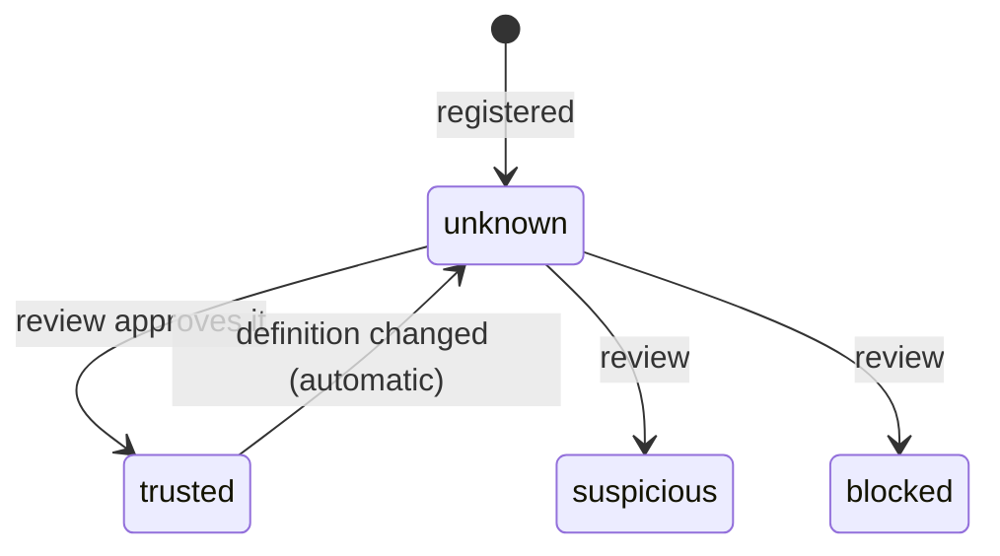

# M4 — Agent & Tool Registry

| | |
|---|---|
| Status | Implemented |
| Semester | FYP-I (weeks 9–10) |
| Owner | Areeb (per proposal) |
| Code | `app/tools.py`, `app/routers/tools.py`, `Tool` and `AgentTool` in `app/models.py` |
| Tests | `tests/test_tools.py` |

## Purpose

Agents act through tools: APIs, internal services and MCP (Model Context Protocol) servers. Often
nobody has checked where a tool comes from, what it can do, or whether it should be trusted, and any
agent can reach any tool. M4 keeps a **registry**: every tool an agent may use, where it comes from,
what it does, how far it is trusted, and which agents may use it.

From the proposal: *a registry mapping agents to the tools and MCP servers they can access,
recording tool capability, provider, endpoint, version, and a trust state (trusted / unknown /
suspicious / blocked).*

## Tools

| Field | Meaning | Example |
|---|---|---|
| `name` | Unique ID: 1–64 lowercase letters, digits, `.`, `_`, `-` | `crm`, `github-mcp` |
| `kind` | `tool` or `mcp_server` | `mcp_server` |
| `provider` | Who supplies it | `internal`, `acme` |
| `endpoint` | How it is reached | `https://crm.internal.example/api`, `stdio: npx @acme/mail-mcp` |
| `version` | The version that was reviewed | `2.1.0` |
| `capabilities` | The actions it performs, using the same action names as [delegations](m3-delegated-authority.md#resources-and-actions) (stored in lower case) | `["read", "crm:update"]` |
| `resources` | What it works on: resource identifiers or prefix patterns, with the same rules and the same one spelling as [delegation resources](m3-delegated-authority.md#resources-and-actions) | `["crm:*"]`, `["mail:outbox/*"]` |
| `trust_state` | `trusted`, `unknown`, `suspicious` or `blocked` | `trusted` |
| `definition_hash` | SHA-256 of kind, provider, endpoint, version, capabilities and resources (computed, read-only); a trust approval must name it | `46fbb30c…` |

Names are unique and lowercase, so one name always means one tool: a second tool cannot register
under, or disguise itself as, the name of one that is already trusted.

`resources` ties a tool to the systems it serves. A delegation says the agent may `read`
`crm:accounts/*`; without the tool's scope, any assigned tool that offers `read` (a web search
tool, say) could be used on those records, sending them to a third party. The gateway refuses a
resource outside the tool's `resources` (`Tool 'websearch' does not work on 'crm:accounts/42'`).
Like capabilities, resources are part of the reviewed definition: widening them resets trust.

## Trust

An administrator can set any state at any time by recording a review; the only automatic change is
trusted → unknown, described below.

| Trust state | What the gateway (M5) does with it |
|---|---|
| `trusted` | Normal checks only |
| `unknown` | A person must approve each use (REQUIRE_APPROVAL) |
| `suspicious` | A person must approve each use (REQUIRE_APPROVAL) |
| `blocked` | Always denied; it cannot even be assigned to an agent |

An administrator records each review with `POST /tools/{tool_name}/trust`, with a reason.
Marking a tool **trusted** must also name the definition that was reviewed, as its
`definition_hash` (the SHA-256 of kind, provider, endpoint, version, capabilities and resources, shown with
every tool). If the tool's definition is no longer that one, because it changed while the reviewer
was looking, the approval is refused (409): a review only ever approves what the reviewer saw.
Marking a tool `suspicious`, `blocked` or `unknown` needs no hash, so stopping a tool is never held
up.

The two directions are guarded against each other. An approval applies only if the tool did not
change since the reviewer read it, and an update (`PUT /tools/{tool_name}`) applies only if neither
the definition nor the trust changed since the update read it; the one that lands second gets 409.
A tool therefore never ends up trusted with a definition that was changed while it was being approved.

### Changing a trusted tool

When the definition of a **trusted** tool changes (its kind, provider, endpoint, version,
capabilities or resources), its trust drops back to `unknown` automatically, with the reason
`Definition changed (version, capabilities); review it again`. Until someone reviews it, every use
needs approval.

This defends against the MCP "rug pull": a server that behaves well while it is reviewed, then
changes what its tools do. A trusted tool cannot gain a capability, reach new resources or move to
another endpoint without a person looking at it again. Changing only the description keeps the trust. Blocked tools
stay blocked whatever changes.

## Which agent may use which tool

An agent may use only the tools an administrator assigned to it (`PUT /agents/{agent_id}/tools/{tool_name}`).
Assigning is repeatable without effect; unassigning (`DELETE`) takes effect at the agent's next
request. Pending agents cannot be given tools, and blocked tools cannot be assigned. An agent reads
its own tools with `GET /identity/tools` (SDK: `client.tools()`).

## Endpoints

Full details in the [API reference](../api-reference.md#tool-registry-m4).

| Endpoint | Caller | Purpose |
|---|---|---|
| `POST /tools` | admin | register a tool or MCP server |
| `GET /tools`, `GET /tools/{tool_name}` | admin | the registry, filterable by trust state and kind |
| `PUT /tools/{tool_name}` | admin | update a definition (may reset trust) |
| `POST /tools/{tool_name}/trust` | admin | record a review |
| `GET /agents/{agent_id}/tools` | admin | an agent's tools |
| `PUT /agents/{agent_id}/tools/{tool_name}` | admin | let the agent use a tool |
| `DELETE /agents/{agent_id}/tools/{tool_name}` | admin | take it away |
| `GET /identity/tools` | agent | the calling agent's tools |

## Using M4 from other modules

The gateway (M5) reads a tool with `db.get(Tool, name)` and an assignment with
`db.get(AgentTool, (agent_id, tool_name))`. `apply_definition` in `app/tools.py` is the only way a
definition should change, so the trust reset cannot be bypassed.

## Design decisions

| Decision | Why |
|---|---|
| The name is the ID, lowercase and unique | Readable in URLs and rules; prevents shadowing a trusted tool with a look-alike name. |
| New tools start `unknown` | Nothing is trusted without a review. |
| Trust resets when a trusted definition changes | A tool cannot change what it does after approval (rug pull). |
| Capabilities use the delegation action names | The gateway can check "does this tool do that action?" and "was that action delegated?" with the same names. |
| Tools are blocked rather than deleted | Decisions in the log keep referring to a tool that still exists, with its history. |

## Limitations and future work

- The registry records what a tool claims to do; Secentic does not inspect tool code or MCP
  manifests itself. Fetching and pinning MCP tool descriptions automatically is future work.
- Trust history keeps only the latest review; the audit log (M11) will record every change.
