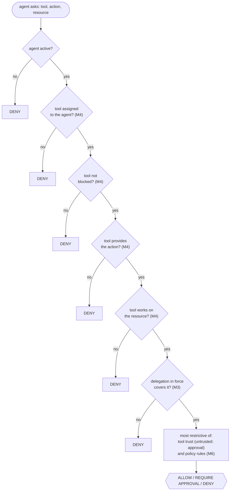

# M5 — Runtime Security Gateway

| | |
|---|---|
| Status | Implemented (core) |
| Semester | FYP-I (weeks 11–12) |
| Owner | Bakhtiar (per proposal) |
| Code | `app/gateway.py`, `app/routers/gateway.py`, `GatewayDecision` in `app/models.py`, `authorize` / `ensure_allowed` in `secentic_sdk/` |
| Tests | `tests/test_gateway.py` |

## Purpose

Everything so far decides *what an agent may do*. The gateway is where that is applied to each
action the agent is about to take. Before an agent uses a tool, it asks the gateway; the gateway
checks identity (M2), the tool (M4), delegated authority (M3) and policy (M6), and answers
**ALLOW**, **DENY** or **REQUIRE APPROVAL** with every reason. Even an agent whose reasoning was
manipulated, for example by a prompt injection, gets a DENY for anything nobody authorised.

From the proposal: *the interception point for consequential agent actions: authenticates the
agent, resolves context, normalizes the requested action, and produces an ALLOW/DENY/REQUIRE-APPROVAL
decision, failing closed for security-sensitive operations if the engine is unavailable.*

## Asking the gateway

An agent sends a signed `POST /gateway/authorize`:

```json
{"tool": "crm", "action": "crm:update", "resource": "crm:accounts/42"}
```

and receives the recorded decision:

```json
{
  "id": "01b65b70-c545-48d8-8984-2f32c4c132a5",
  "decision": "require_approval",
  "reasons": [
    "Tool 'crm' (trusted) is assigned to the agent and provides 'crm:update' on 'crm:accounts/42'",
    "Allowed by delegation 8d611aea-…: task 'Prepare the monthly sales report', delegated by ali, valid until 2026-10-13T06:47:18Z",
    "Policy rule 'crm-updates-need-approval' (require_approval): Changes to customer records need a person's approval"
  ],
  "matched_rules": ["crm-updates-need-approval"],
  "delegation_id": "8d611aea-…",
  "policy_version": 1,
  ...
}
```

The agent proceeds **only on `allow`**. With the SDK:

```python
client.ensure_allowed("crm", "crm:update", "crm:accounts/42")   # raises ActionNotAllowed unless allowed
update_the_record()                                              # runs only if the gateway allowed it
```

Every request is first authenticated like any agent request (M2): signed, fresh, not replayed, from
an active agent. Then, as in step 4 of the proposal's authorization flow, the tool, action and
resource are **normalised**: validated (the formats of
[M3](m3-delegated-authority.md#resources-and-actions) and [M4](m4-agent-tool-registry.md#tools)) and
brought to their one canonical spelling, e.g. `READ` on `crm:accounts:42` becomes `read` on
`crm:accounts/42`. Anything malformed is refused before any decision (422). The decision, its
reasons and the decision log all use the normalised form.

## The decision



| # | Check | If it fails |
|---|---|---|
| 1 | The agent is active | DENY `Agent is <status>` |
| 2 | The tool is assigned to the agent | DENY `Agent 'a' is not allowed to use tool 'x'`, also when the tool is not registered at all |
| 3 | The tool is not blocked | DENY `Tool 'x' is blocked: <reason>` |
| 4 | The tool provides the action | DENY `Tool 'x' does not provide the action 'y'` |
| 5 | The tool works on the resource (its `resources`) | DENY `Tool 'x' does not work on 'r'` |
| 6 | A delegation in force covers the action on the resource | DENY with M3's reason |
| 7 | The tool is trusted | REQUIRE APPROVAL `Tool 'x' is unknown: a person must approve its use` |
| 8 | Policy rules | DENY or REQUIRE APPROVAL, naming each matching rule |

Assignment is checked before anything else about the tool, and an unregistered tool gets the same
answer as an unassigned one. An agent therefore learns nothing about tools it was not given: not
whether they exist, nor whether, or why, an administrator blocked them.

Check 5 stops a tool being used on another system's data: a delegation to read CRM accounts does
not let the agent read them through a web search tool that also offers `read`.

Checks 1–6 stop at the first failure. When they all pass, the decision is the most restrictive of
checks 7 and 8, and the reasons list every check that passed and every rule that matched. The order
is fixed, so the same request in the same state always gets the same decision and explanation.

REQUIRE APPROVAL means "not now": the agent must not proceed. The approval workflow that lets a
person approve that exact request is M8 (FYP-II).

## Failing closed

If anything inside the gateway fails (the database is unreachable, a stored policy is corrupt, an
unexpected error), the answer is **503 with `The gateway could not reach a decision; failing closed
(deny)`**, and nothing is recorded as allowed. Agents must treat any answer other than an
explicit `allow` as a denial; `ensure_allowed` does this for them (it raises on 503 too).
A database failure before the gateway is reached, while the request is being authenticated, also
answers 503 (`The database could not complete the request; ...`), never a bare 500.

## The decision log

Every answer to `POST /gateway/authorize` is stored with the agent, the key that signed the request,
the tool, action, resource, decision, reasons, matched rules, delegation and policy version. The
answer is built from that record before it is stored and nothing is read back afterwards, so the
agent is always told exactly what the log says (a failure after storing it can never turn a logged
`allow` into a 503).
Administrators read it with `GET /gateway/decisions` (newest first, filterable by agent and
decision). This is the trail the audit module (M11) will make tamper-evident and the activity
module (M9) will make searchable.

Administrators can also ask what the gateway *would* decide for any agent, now or at another moment,
with `POST /gateway/simulate`. Simulations are not recorded. For another moment, the delegations
(including whether they had been revoked by then) and the policy version in force then are used; the agent's status, its tools and their trust are
taken as they are now, because they keep no history yet (the audit log, M11, will provide it).

## Endpoints

Full details in the [API reference](../api-reference.md#gateway-m5).

| Endpoint | Caller | Purpose |
|---|---|---|
| `POST /gateway/authorize` | agent (signed) | ask before acting; the decision is recorded |
| `POST /gateway/simulate` | admin | dry run for any agent and moment |
| `GET /gateway/decisions` | admin | the decision log |

## Using M5 from other modules

`decide(db, agent, tool, action, resource, at=None)` in `app/gateway.py` returns a `GatewayResult`
(decision, reasons, matched rules, delegation ID, policy version) and never records anything; the
router records and fails closed. The risk engine (M7) will become one more input to the "most
restrictive" step, and the approval workflow (M8) will act on REQUIRE APPROVAL decisions by their ID.

## Design decisions

| Decision | Why |
|---|---|
| A decision service that agents call before acting | Works with any tool, any protocol and any agent framework; the SDK makes it one call. |
| Fixed check order, first failure ends it | Deterministic, cheap, and the explanation names the real reason. |
| Most restrictive of trust and policy wins | No single check can relax another. |
| Every decision recorded before it is returned | An allowed action always has a record; if recording fails, the answer is a denial. |
| 503 on any internal error | Fail closed: an unknown state never becomes an ALLOW. |

## Limitations and future work

- **Cooperative enforcement.** The gateway decides; the agent's runtime (through the SDK) must ask
  and obey. An agent that calls a tool directly, without asking, is not stopped. Enforcing at the
  network level, by proxying tool and MCP traffic through the gateway so tools only accept calls it
  forwards, is future work, and is the main residual risk of this design
  (see [security.md](../security.md#residual-risks)).
- REQUIRE APPROVAL has no workflow yet (M8): it currently means "do not proceed".
- The decision log is a normal table; it becomes tamper-evident with M11.
