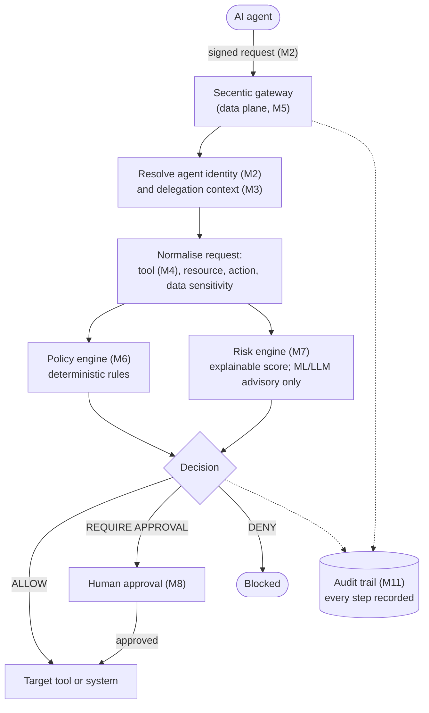

# Project overview

## The problem

AI agents are no longer chatbots. They read data on their own, call tools and APIs, change
records, send messages and run code, often with little human checking in between. Organisations
are connecting them to enterprise systems, cloud services and external tool servers (for
example MCP servers), and that has opened a governance gap:

- **Nobody has a reliable list of the agents that are running** ("agent sprawl", "shadow agents").
- **Ownership is unclear**: who is responsible for an agent, and whose authority was it acting on?
- **Agents are over-privileged**: they inherit a human's or a service account's full permissions.
- **Tool access is uncontrolled**: agents reach tools and MCP servers nobody has vetted.
- **Authorisation ignores context**: static roles do not consider the task, the data, or the risk.
- **Prompt injection turns into actions**: instructions hidden in content an agent reads (an
  email, a web page, a document) can manipulate it into doing something harmful
  ([InjecAgent][1], [AgentDojo][2]).
- **There is no trustworthy audit trail** linking an agent, its authority, the policy check and
  the outcome.

Security controls built for humans and fixed service accounts do not fit agents, which act
autonomously, on delegated authority, while reading untrusted content.

## The idea

Secentic is a **security control plane for AI agents**. It does not try to make an agent's
reasoning safe, which nobody can guarantee. Instead it **constrains what the agent can do**:

> Even if an agent's reasoning is manipulated or simply wrong, its actions stay limited by its
> identity, the authority a human delegated to it, a deterministic policy, and enforcement at
> runtime.

Every consequential action an agent attempts passes through a Secentic gateway, which checks it
and returns **ALLOW**, **DENY** or **REQUIRE APPROVAL** before the action reaches the real system.

## Architecture at a glance

The system is split into planes, so that *deciding the rules* is separate from *enforcing them on
each request*:

| Plane | Responsibility | Modules |
|---|---|---|
| Control plane | Inventory, identity, delegation, policy management, approvals, administration | M1, M2, M3, M4, M8, M12 |
| Data plane | The runtime gateway that intercepts and authorises agent actions in real time | M5 |
| Security engine | Deterministic policy evaluation plus explainable risk scoring | M6, M7 |
| Event plane | Activity, decision and security events, alerts | M9, M10 |
| Storage plane | Relational database, plus a tamper-evident audit log | all, M11 |

One principle runs through the whole design: **a language model may inform context or make a
suggestion, but it never makes the final security decision.** Enforcement stays deterministic,
explainable and auditable.

The technical design of what exists today is in [architecture.md](architecture.md).

## Modules and status

The project is divided into twelve modules that can each be built, tested and demonstrated on
their own, six per semester. FYP-I builds the identity and enforcement foundation; FYP-II adds
risk, response and visibility on top of it.

| Module | Semester | Owner(s) per proposal | Status | Documentation |
|---|---|---|---|---|
| **M1** Agent Discovery & Asset Inventory | FYP-I | Ali | **Implemented** | [M1](modules/m1-agent-inventory.md) |
| **M2** Agent Identity & Non-Human Identity | FYP-I | Ali, Areeb | **Implemented** | [M2](modules/m2-agent-identity.md) |
| **M3** Delegated Authority | FYP-I | Bakhtiar, Areeb | **Implemented** | [M3](modules/m3-delegated-authority.md) |
| **M4** Agent & Tool Registry | FYP-I | Areeb | **Implemented** | [M4](modules/m4-agent-tool-registry.md) |
| **M5** Runtime Security Gateway (core) | FYP-I | Bakhtiar | **Implemented** | [M5](modules/m5-runtime-gateway.md) |
| **M6** Contextual Policy Engine (core) | FYP-I | Bakhtiar, Areeb | **Implemented** | [M6](modules/m6-policy-engine.md) |
| **M7** Risk Engine | FYP-II | — | Planned | — |
| **M8** Human Approval Workflow | FYP-II | — | Planned | — |
| **M9** Runtime Activity & Investigation | FYP-II | — | Planned | — |
| **M10** Security Alerts, Incidents & Quarantine | FYP-II | — | Planned | — |
| **M11** Audit & Compliance | FYP-II | — | Planned | — |
| **M12** CISO / SOC Dashboard & Permission Analytics | FYP-II | — | Planned | — |

What each planned module is meant to do (from the FYP-I proposal):

- **M7 Risk Engine**: an explainable 0–100 score from signals such as sensitive data, privileged
  actions, unknown tools, external destinations and unusual volume; LOW / MEDIUM / HIGH / CRITICAL.
- **M8 Human Approval Workflow**: approvals bound exactly to the agent, task, tool, resource and
  context they were granted for, with expiry and replay prevention.
- **M9 Runtime Activity & Investigation**: searchable stream of sessions, tool calls and decisions,
  with an activity graph (user → agent → session → tool → resource).
- **M10 Alerts, Incidents & Quarantine**: alerts on violations, repeated denials and unknown tools;
  quarantine actions (suspend agent, revoke identity, block tool, require approval for everything).
- **M11 Audit & Compliance**: append-only, hash-chained audit log with search and export.
- **M12 CISO / SOC Dashboard**: inventory, risk posture, blocked actions, approval backlog, and
  granted-versus-used permission analytics.

## Scope

In scope: an MVP control plane, a working prototype of each module, a documented and explainable
policy model, an SDK for agents, and an evaluation against agent attack scenarios such as indirect
prompt injection and tool misuse.

Out of scope for the FYP (possible future work): multi-cloud and Kubernetes-native discovery, SIEM
integrations (Splunk, Sentinel), full SSO/OIDC administration, advanced behavioural analytics and
multi-region high availability.

The project's claim is architectural, not absolute: it does not promise to detect every prompt
injection. It shows that an agent's actions stay constrained by identity, delegated authority,
deterministic policy and runtime enforcement even when its reasoning is compromised.

## Research basis

The design is grounded in recent work on tool-using LLM agents:

| Theme | Studies | Modules it motivates |
|---|---|---|
| Indirect prompt injection | [InjecAgent][1]; [AgentDojo][2] | Gateway, policy, risk, approval |
| Tool and agent risk evaluation | [ToolEmu][5]; [Penetration testing of agentic AI][8] | Tool registry, risk engine |
| Agent permissions and access control | [Automating data access permissions][3]; [RBAC for AI agents][4] | Delegated authority, policy |
| System-level defences | [Architecting secure AI agents][7] | Control plane, gateway, approval |
| Autonomous offensive capability | [Teams of LLM agents exploit zero-days][9] | Least privilege, quarantine |
| Instruction hierarchy | [The instruction hierarchy][10] | Context, deterministic policy |

[1]: https://arxiv.org/abs/2403.02691
[2]: https://arxiv.org/abs/2406.13352
[3]: https://arxiv.org/abs/2511.17959
[4]: https://arxiv.org/abs/2509.11431
[5]: https://arxiv.org/abs/2309.15817
[7]: https://arxiv.org/abs/2603.30016
[8]: https://arxiv.org/abs/2512.14860
[9]: https://arxiv.org/abs/2406.01637
[10]: https://arxiv.org/abs/2404.13208

## Team

Final Year Project, Department of Cyber Security & Artificial Intelligence, FAST National
University (Karachi), session Fall 2026. Supervisor: Sandesh Kumar.
Members: Syed Bakhtiar Ahmed (group leader), Syed Areeb Hussain, Ali Hyder Bhellar.
